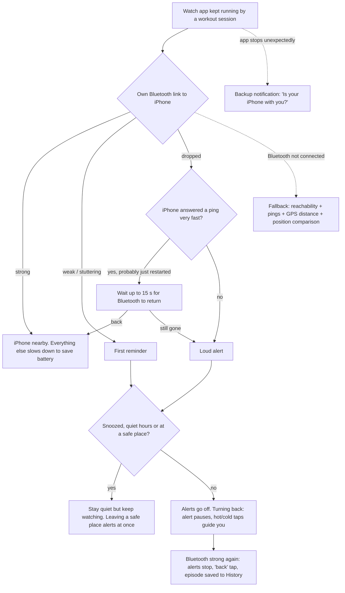

# DiTether

Your Apple Watch tells you the moment you walk away from your iPhone. DiTether works without internet, has no account and no server, and keeps all data on your own two devices.

> **Status: tested on a real iPhone and Apple Watch, and working.** The core protection was tested on hardware (iPhone with Apple Watch on watchOS 26). It builds and installs from Xcode, runs in the background, and alerts when you walk away from the iPhone over its own Bluetooth link. Features added after that test are marked *built, awaiting device test* in [Testing status](#testing-status).

---

## Contents

- [Features](#features)
- [How it works](#how-it-works)
- [How it was built](#how-it-was-built)
- [Set up](#set-up)
- [Testing status](#testing-status)
- [Known limits](#known-limits)
- [Project layout](#project-layout)

---

## Features

### Knowing your iPhone is gone

- **Bluetooth range (main signal).** The watch keeps its own direct Bluetooth link to DiTether on the iPhone and reads the signal strength every few seconds.
  - **Fading or stuttering signal:** first reminder.
  - **Link fully dropped:** loud alert, right away.
  - A direct Bluetooth link can't be carried over Wi-Fi or iCloud, so a watch that is still connected through Wi-Fi can't hide that the phone is gone.
- **Live signal on the watch.** Bars plus "Strong", "Weak" or "No signal". When there is no link, the watch says why ("Allow Bluetooth for DiTether", "Bluetooth is off", "Looking for iPhone…").
- **Backup signals** take over automatically if Bluetooth isn't connected:
  - **Reachability:** Apple's flag that says whether the iPhone can be reached.
  - **Live pings:** the watch messages the iPhone and waits for a reply.
  - **Walk-away distance:** GPS distance from the spot where the phone was left.
  - **Position comparison:** the watch compares its own position with the one the iPhone shares.
- **False-alarm protection:**
  - Every alert is double-checked first.
  - A strong Bluetooth signal overrules every other signal.
  - Readings with a large GPS error margin are ignored.
  - Right after an iPhone restart, a quick reply to a ping makes the loud alert wait up to 15 s for Bluetooth to come back.

### Alerts

- **Two steps:** a **first reminder** (a short tap), then a **loud alert** that repeats until the phone is back or you silence it.
- **Vibration style:** Light, Standard or Persistent.
- **Alert timing:** adjustable delays, walk-away distance (30–500 m), and how long the loud alert repeats. A "Use recommended settings" button restores the defaults.
- **Detection mode:** Fast, Balanced (recommended) or Battery Saver. Trades how quickly the phone's absence is noticed against battery.
- **The alarm stops when you open the app.** Opening DiTether on the watch during an alert stops the buzzing. Watching continues.
- **Backup notifications.** These are scheduled in advance, so an alert still arrives if watchOS suspends the app. If the background session ever ends, you're told: "DiTether stopped watching".
- **"Back" tap** when the iPhone is in range again.

### Finding your iPhone (and your watch)

- **Hot/cold taps, like a metal detector.** Once you turn back toward where you left the phone (detected with GPS), the loud alert pauses and the watch taps faster as you get closer. Up close, the Bluetooth signal takes over. Walking away again brings the loud alert back.
- **Find iPhone screen:** a live signal gauge, "Getting closer / Getting farther", and the same hot/cold taps.
- **Ring iPhone:** the iPhone plays a loud beep for 30 s, even on silent. It stops when you open DiTether on the iPhone, tap Stop on the watch, or after 30 s.
- **Ring my watch** from the iPhone: the watch buzzes and beeps for 20 s.
- **History with a map:** every alert episode, with where it happened, how far you walked and how long you were apart, plus an "Open in Maps" link.

### Staying quiet when it's fine

- **Safe places:** home, work and so on, each with an adjustable radius. Quiet is not the same as off: walking out of a safe place without your iPhone alerts you right away.
- **Quiet hours,** for example 22:00–07:00.
- **Silence for** 30 min / 1 h / 3 h / 8 h, from either device.
- **Protection switch** on the watch's main screen and on the iPhone.

### Setup and everyday use

- **Intro on the iPhone:** what DiTether does, how it alerts, the one rule ("keep it open"), speed versus battery, and a live **setup checklist** that ticks itself off.
- **Checklist steps take you to the right place:**
  - "Pair" and "Install" open the iPhone's Watch app.
  - "Open DiTether on your watch" launches the watch app from the iPhone.
  - Permission steps show the permission prompt, or open the Settings app if it was denied.
- **Intro on the watch** that explains each permission before the system asks for it.
- **Status screen with one clear answer:** "You're protected", "Install DiTether on your watch", "Your watch needs attention", and so on. Each comes with a button to fix it.
- **Test alerts** sent from the iPhone, or previewed on the watch.
- **Watch face complication:** Nearby / Apart / Left? / Quiet / Off, in circular, corner, rectangular and inline sizes.
- **Connection log on the watch:** what the watch noticed and why, useful after a walk test.

### Battery

- **Bluetooth first.** While the Bluetooth link is healthy, everything else slows down:
  - the iPhone stops sharing its location,
  - pings drop to one every 2 minutes,
  - the watch reads its position about every 2 minutes,
  - the main loop runs every 10 s.
- **While apart, things calm down:**
  - after a long separation, or while quiet at a safe place, GPS switches from continuous to one reading a minute or every 2 minutes;
  - Bluetooth scanning runs in short bursts;
  - automatic hot/cold taps stop after 10 minutes.
- **GPS precision on demand.** Precise GPS only while measuring a walk-away or guiding you back.

### Privacy

- No account, no server and no analytics.
- Locations, history and logs stay on the iPhone and Apple Watch, and are left out of iCloud backups.
- "Clear history", or deleting the app, removes them.
- Workout access only keeps the watch app running. Nothing is read from or saved to Health.

---

## How it works



- **The watch decides everything itself.** The iPhone app is for settings, safe places, history, test alerts and ringing.
- **The watch's alert engine** (`ProtectionEngine`) runs one loop: every 2 s while something is happening, every 10 s while resting on a healthy Bluetooth link. Bluetooth and connectivity changes are acted on instantly, not at the next loop.
- **Bluetooth thresholds:** the signal is smoothed. Below −84 dBm counts as weak, and it must climb back above −78 dBm to count as strong again, so a signal hovering at the edge doesn't keep flipping.
- **Walk-away distance** is measured conservatively. The reading's own error margin is subtracted, and readings worse than 65 m or older than 30 s are ignored.
- **Settings sync between the devices.** The newest copy wins, except the snooze, which comes from whichever side changed it last. Both devices merge the same way, so they always end up identical.

### Detection modes

| | Fast | Balanced | Battery Saver |
|---|---|---|---|
| Bluetooth signal reading | every 3 s | every 5 s | every 10 s |
| Ping when Bluetooth isn't connected | every 5 s | every 10 s | every 30 s |
| iPhone shares its location (only when Bluetooth isn't connected) | yes | yes | no |
| GPS while apart | precise | precise | moderate |

---

## How it was built

**Language and UI:** Swift 5 and SwiftUI on both devices. Deployment targets are iOS 17 and watchOS 10.

**Project:** generated with [XcodeGen](https://github.com/yonaskolb/XcodeGen) from `project.yml`. Signing settings and the bundle prefix live in `Config/Local.xcconfig`. There are three targets:

| Target | Platform | What it is |
|---|---|---|
| `Tether` | iOS | The iPhone app, shown as **DiTether** (the watch app is embedded inside it) |
| `TetherWatch` | watchOS | The watch app: alert engine, alerts and screens |
| `TetherWatchWidgets` | watchOS | The watch face complication (WidgetKit extension) |

**Apple frameworks used:**

| Framework | Used for |
|---|---|
| **CoreBluetooth** | The iPhone advertises a private Bluetooth service (`CBPeripheralManager`). The watch connects to it and reads the signal strength (`CBCentralManager`, `readRSSI`). |
| **HealthKit** | A workout session with its live workout builder keeps the watch app running in the background. Nothing is collected, and the workout is discarded when it ends. Also used for `startWatchApp`, which opens the watch app from the iPhone. |
| **WatchConnectivity** | Settings sync (application context), history and status (queued transfers), and live messages: pings, test alerts, ring commands. |
| **CoreLocation** | Watch GPS for walk-away distance, safe places and the drop spot. iPhone location for safe places and the fallback position comparison. |
| **UserNotifications** | Alerts, scheduled backup notifications and the "Here's your iPhone" notification. |
| **WidgetKit** | The watch face complication. It shares a small status record with the watch app through an App Group. |
| **AVFoundation** | The ring tone on the iPhone. It is generated in code as a WAV, so no sound file is bundled, and the playback category lets it ring on silent. |
| **WatchKit** | Haptic patterns, lifecycle events (becoming active, workout recovery, launch from the iPhone). |

**Design choices:**
- The watch makes every decision, so alerts work even when the iPhone is out of reach.
- Every alert is confirmed before firing, and Bluetooth overrules weaker evidence. Both exist to avoid false alarms, which are the top complaint about competing apps.
- Battery is managed by lowering how often things are checked, never by delaying the first reminder or the loud alert.
- Saved files tolerate missing fields, so adding a setting in a new version never resets safe places or history.

---

## Set up

1. Install Xcode. Turn on **Developer Mode** on the iPhone and the watch (Settings → Privacy & Security).
2. In Terminal: `cd Tether && ./setup.sh com.yourname YOURTEAMID`
   - **Team ID:** Xcode → Settings → Accounts → your team. You can also edit `Config/Local.xcconfig` by hand.
   - The script installs XcodeGen with Homebrew if needed and creates `Tether.xcodeproj`.
3. Open the project, choose the **Tether** scheme, pick your iPhone and press Run. The watch app installs through the iPhone.
   - If Xcode asks about capabilities, let it fix signing for all three targets: HealthKit, and the App Group `group.<your prefix>.tether`.
4. **On the iPhone:** go through the intro and complete the checklist:
   - allow Bluetooth and location,
   - open DiTether on the watch,
   - add your home.
5. **On the watch:** tap **Get started**, then allow Notifications, Bluetooth, Location and Workout.
6. Check that the watch shows **Strong signal**. Then add the DiTether complication to your watch face if you like.

**Other notes:**
- After changing `project.yml`, run `./setup.sh` again or `xcodegen generate`. The `.xcodeproj` is generated and not checked in.
- If Xcode's console shows `Application context data is nil`, that's harmless. So is the "Could not get trait set" warning about the asset catalog.
- A free Apple ID build expires after 7 days and has to be reinstalled from Xcode.

---

## Testing status

**Tested on a real iPhone and Apple Watch, and working:**
- Building, installing and launching both apps from Xcode.
- Background protection with the workout session (the Smart Stack shows the session timer while it runs).
- The Bluetooth link: the watch shows **Strong signal**.
- Walk-away alerts over Bluetooth.
- The fix for the crash when background GPS turned on (the `UIBackgroundModes` → `location` entry).

**Built and compile-checked, awaiting device test:**
- Ring iPhone / Ring my watch.
- The hot/cold finder and the turn-back taps.
- Vibration styles.
- The alarm stopping when the app is opened.
- The restart grace period.
- The watch face complication.
- Opening the watch app from the iPhone's setup steps.
- The battery-saving changes (Bluetooth-first pacing, calm mode while apart, scan bursts).

The watch's **Connection log** (watch Settings → Connection log) records each decision with a time, which is the quickest way to check any of these on a walk test.

---

## Known limits

1. **Don't swipe DiTether away on the iPhone.** Its Bluetooth signal stops with it, and the watch will alert. After restarting the iPhone, DiTether relaunches on the watch's next ping. Opening it once makes sure.
2. **Swiping DiTether away on the watch** ends the background session. You get a "DiTether stopped watching" notification. Open the app, or tap **Open on watch** on the iPhone, to restart it.
3. **The workout session is the biggest battery cost.** It keeps the heart-rate sensor on and shows a timer in the Smart Stack. Use the Protection switch when you don't need DiTether.
4. **Add DiTether to your Focus / Do Not Disturb allowed apps**, or alerts will be silenced.
5. **GPS features need the sky.** Indoors, walk-away distance and turn-back detection can't be relied on. Bluetooth and the timers still work.
6. **Thresholds may need tuning for your devices.** The −84 dBm "weak" threshold is a starting point. The Connection log shows the dBm values to tune from.
7. **Only the watch-alerts-for-phone direction is built.** An iPhone alert for a forgotten watch is not.
8. **The App Store would likely reject this design.** Apple's review guidelines only allow workout sessions for real workouts. This build is meant for personal installs from Xcode.

---

## Project layout

```
Shared/              Code used by both apps
  Models.swift         Settings, detection modes, alert styles, events, status, commands
  Storage.swift        Saved files (missing fields tolerated, settings merge rules)
  ConnectivityService  WatchConnectivity: sync, pings, live commands
  ProximityService     The private Bluetooth service ID
  Suppression.swift    Quiet rules: snooze, quiet hours, safe places
  WidgetState.swift    Status shared with the complication

TetherWatch/         Watch app
  ProtectionEngine     The alert engine (detection, escalation, battery pacing)
  ProximityMonitor     Bluetooth link and signal strength
  KeepAliveSession     Background workout session
  AlertCenter          Haptics and notifications
  GuideHaptics         Hot/cold taps
  WatchLocation        GPS
  ConnectionLog        On-watch decision log
  Views/               Status, Find iPhone, intro, settings, log, test/ring screens

TetherWatchWidgets/  Watch face complication

Tether/              iPhone app
  PhoneModel           Wires everything together
  ProximityBeacon      Bluetooth signal for the watch
  PhoneLocation        Safe places and fallback location sharing
  PhoneRinger          "Ring iPhone" sound
  WatchLauncher        Opens the watch app or the Watch app
  SetupState           Status card and setup checklist logic
  Views/               Intro, Status, History, Settings, Safe places, Alert timing

project.yml          XcodeGen spec
Config/              Personal signing settings
setup.sh             One-step setup
```
