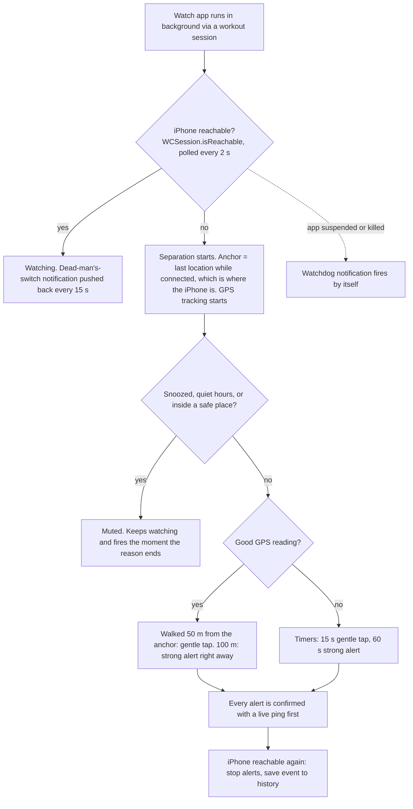

# DiTether

Your Apple Watch alerts you when your iPhone is left behind, with no internet needed and no server.

**Status: written but never compiled or run.** It was produced without access to Xcode, so expect to fix a few compile errors on first build. Nothing here has been tested on a real watch.

## How it works

- **Tier 1** gentle tap and **Tier 2** strong alert each have their own on/off switch and delay.
- **Distance beats time.** Three signals work together: the reachability flag is the instant trigger, a live ping confirms it, and distance from the drop-point decides how fast to escalate. Phone in the next room: you stay near the spot, so only the timers apply. Phone left at the café: you walk away, and the strong alert fires at 100 m (adjustable 50 to 500 m) even if 60 seconds haven't passed.
- Distance is measured conservatively: the reading's own error margin is subtracted, and readings worse than 65 m or older than 30 s are ignored, so GPS jitter can't fake a walk-away.
- The watch decides everything itself. The iPhone app is for settings, safe places and history (with a map of where the watch was when the link dropped).
- History stays on the devices (no account, no server, excluded from backups). "Clear history" or deleting the app removes it.

## Set up (Mac)

1. Install Xcode. Turn on **Developer Mode** on the iPhone and the watch (Settings > Privacy & Security).
2. In Terminal: `cd Tether && ./setup.sh com.yourname YOURTEAMID`
   - Team ID: Xcode > Settings > Accounts > your team. You can also edit `Config/Local.xcconfig` by hand.
   - This installs XcodeGen with Homebrew if needed and creates `Tether.xcodeproj`.
3. Open the project, choose the **Tether** scheme, pick your iPhone, press Run. The watch app installs through the iPhone app (or run the **TetherWatch** scheme on the watch).
4. The iPhone app opens with a short intro and a setup checklist that ticks itself off. On the watch, tap **Get started** on the intro screen, then allow Notifications, Location and Workout (Health) access. The workout session is only a trick to keep the app alive. Nothing is saved to Health.
5. Open Tether on the iPhone, add your home and work under Settings > Safe places.

A free Apple ID build expires after 7 days and must be re-installed from Xcode. If Xcode says your team cannot use the HealthKit capability, the paid developer program is needed.

## Known limits, in order of importance

- **Don't swipe Tether away on the iPhone.** A force-quit app makes the watch think the phone is gone. After restarting the iPhone, open Tether once.
- Apple's forums report that `isReachable` can be stale or wrong during workout sessions on some watchOS versions. To guard against that, the watch also pings the iPhone directly every 15 s, and two missed pings count as "apart". It only believes "reconnected" after the iPhone answers a ping.
- If the app is force-quit mid-session, Tether takes over the still-running workout session instead of starting a second one.
- `isReachable` is the only signal Apple exposes. It can also stay true over shared Wi-Fi, and it can lag a few seconds.
- Distance escalation needs GPS. Indoors, or with location off, it quietly falls back to the timers. Watch GPS takes a few seconds to warm up after the link drops.
- While apart (including muted at a safe place), the watch runs GPS continuously, which costs extra battery. While together it takes one cheap reading per minute.
- Background GPS on the watch relies on the "location" background mode plus the workout session. Untested on a device.
- The background workout session uses battery. Turn Protection off when you don't need it.
- If the watch app is ever suspended, a watchdog notification ("Is your iPhone with you?") fires on its own as a backup, which can be a false alarm.
- Add Tether to your Focus / Do Not Disturb allowed apps or alerts will be silenced.
- Only the watch-alerts-for-phone direction is built. Phone-alerts-for-watch is not.

## Layout

`Shared/` models, storage, WatchConnectivity, quiet-rules logic. `TetherWatch/` protection engine, alerts, workout keep-alive, watch screens. `Tether/` iPhone screens. `project.yml` is the XcodeGen spec.
